# Part 2 — Analysis and Design

## 10. System Analysis
**Problem decomposition.** Five concerns, each isolated in code: (1) identity and tenancy, (2) conversational AI with retrieval, (3) statistical prediction, (4) document understanding, (5) medication safety. They share one database and one authentication model.

**Key design decisions (and why)**
| Decision | Reason |
|---|---|
| Database access uses the **caller's JWT**, not the service role | Postgres RLS then enforces isolation even if application code has a bug |
| Service role only for audit log, admin listing, account deletion | Minimises blast radius; key never reaches the browser |
| Model trained offline, artifact committed (≈ small joblib) | No training at request/deploy time; lightweight for serverless |
| OCR in a separate Docker worker | Tesseract is a system binary, unavailable on Vercel |
| Emergency detection by regex **before** the LLM | Deterministic, instant, cannot be skipped by model behaviour |
| Retrieval only from `approved` chunks | Prevents unreviewed text from being cited as authoritative |
| OCR output never auto-saved as truth | `user_confirmed` required; saved rows have `verified=false` |

## 11. Stakeholder Analysis
| Stakeholder | Interest | Influence | Needs |
|---|---|---|---|
| Patient | Understand heart-health information safely | High | Clear Arabic, privacy, no false reassurance |
| Medical reviewer | Quality of knowledge base | Medium | Approve/reject sources, see provenance |
| Administrator | Operate the platform | High | User management, health, audit |
| Professor / examiner | Academic rigour | High | Real implementation, honest results, documentation |
| Treating doctor / pharmacist | Not a user, but final authority | High | App must defer to them |
| Regulators (Egypt) | Data protection, medical-software rules | High | Consent, minimisation, no unvalidated diagnostic claims |
| Third-party providers (Google, Supabase) | Data processors | Medium | Terms, data-processing safeguards |

## 12. Use Case Model
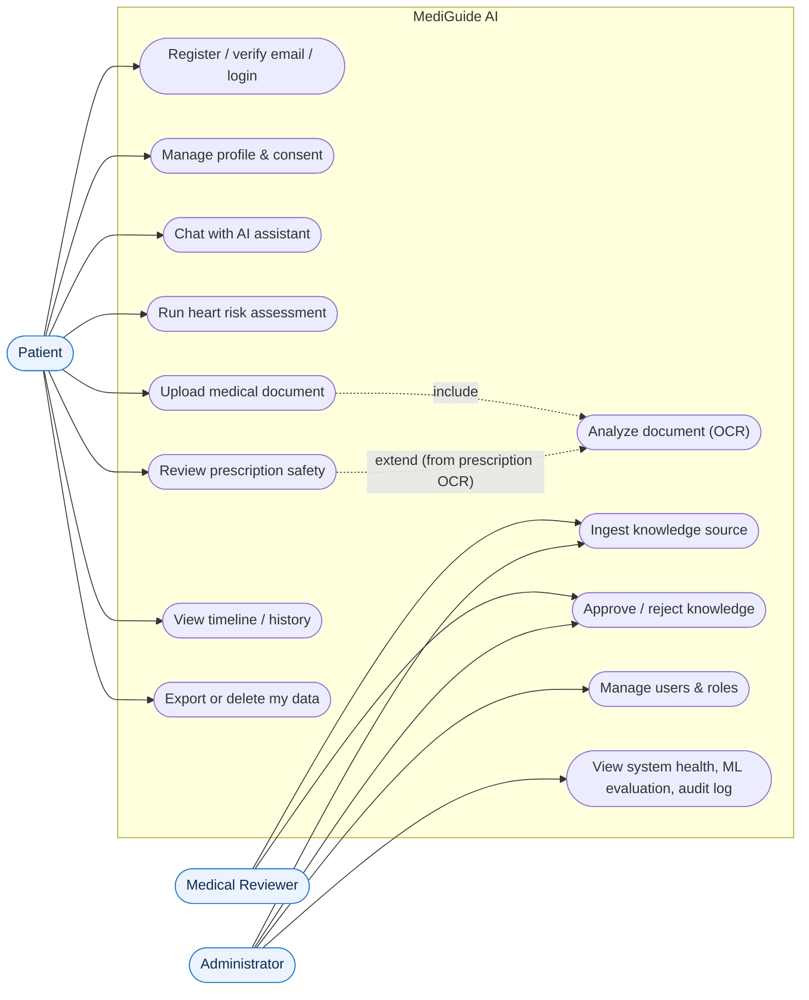

*(Source: `docs/diagrams/02_use_case.mmd`; rendered PNG: `docs/diagrams/png/02_use_case.png`)*

## 13. Detailed Use Case Specifications
**UC-01 Register and verify.** *Actor:* Visitor. *Pre:* none. *Main flow:* 1) enters name, email, password, ticks disclaimer; 2) client validates (Zod); 3) Supabase `signUp` stores user, trigger creates `profiles` row with role `patient`; 4) email sent; 5) user clicks the link; 6) session created, redirect to `/app`. *Alternates:* weak password → inline error; unverified login → "Email not confirmed". *Post:* a profile exists. *Tested:* E2E registration test reads the real email from Mailpit.

**UC-03 Chat with assistant.** *Actor:* Patient. *Pre:* logged in, AI consent given, `GEMINI_API_KEY` configured. *Main flow:* see sequence diagram in §15. *Alternates:* (a) emergency phrase → deterministic 123 warning first; (b) no approved source → answer flagged "general information"; (c) Gemini error → SSE `error` event, partial text preserved; (d) rate limit 15/min → 429. *Post:* user and assistant messages stored with sources.

**UC-04 Heart-risk assessment.** *Main flow:* form (13 UCI fields, range-validated twice: Zod + Pydantic) → `POST /api/predict` → `ml_service.predict` → row saved → result with model version, test metrics of the selected model, limitations, recommendations, disclaimer. *Alternates:* artifact missing → 503 `model_missing`; invalid input → 422 with field names (values not echoed).

**UC-05/06 Upload and analyze document.** *Main flow:* §15 upload sequence. *Alternates:* wrong magic bytes / extension mismatch / > 20 MB / corrupt → 422; X-ray PDF → 422; OCR unavailable → 503 `ocr_unavailable` and document status `failed`; low OCR confidence → warnings.

**UC-07 Review prescription.** *Main flow:* optional import of OCR medications → user edits → `POST /api/prescriptions/review` → warnings/interactions/DailyMed → user confirms → save. *Alternates:* saving without confirmation → 422 `confirmation_required`.

**UC-10/11 Knowledge ingest and approval.** Reviewer/admin submits text with source metadata → chunks stored `pending` → approve/reject per chunk. Patients can neither see nor retrieve pending chunks.

**UC-12 Manage users.** Admin changes role/suspends. Cannot demote/suspend self (409). Suspended users receive 403 on every API call.

## 14. System Architecture
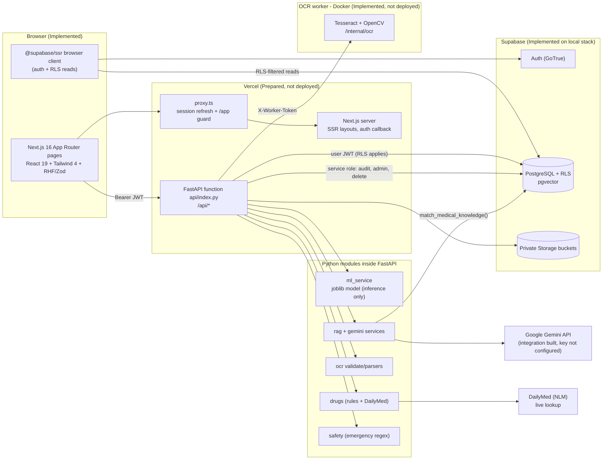

*(Source: `docs/diagrams/01_architecture.mmd`; rendered PNG: `docs/diagrams/png/01_architecture.png`)*

**Layers.** *Presentation* (Next.js pages, `components/`), *API* (FastAPI routers), *Domain services* (`services/`, `ocr/`), *Data* (Supabase). The browser talks to Supabase directly **only** for authentication and RLS-filtered reads (profile, lists); every action with business rules (predict, chat, upload, review, admin) goes through FastAPI.

> **بالعربي:** المتصفح يتكلم مع Supabase للدخول وقراءة بياناته فقط، وكل العمليات الحساسة تمر عبر FastAPI الذي يتحقق من الهوية والصلاحيات.

## 15. System Workflows
### 15.1 Authentication
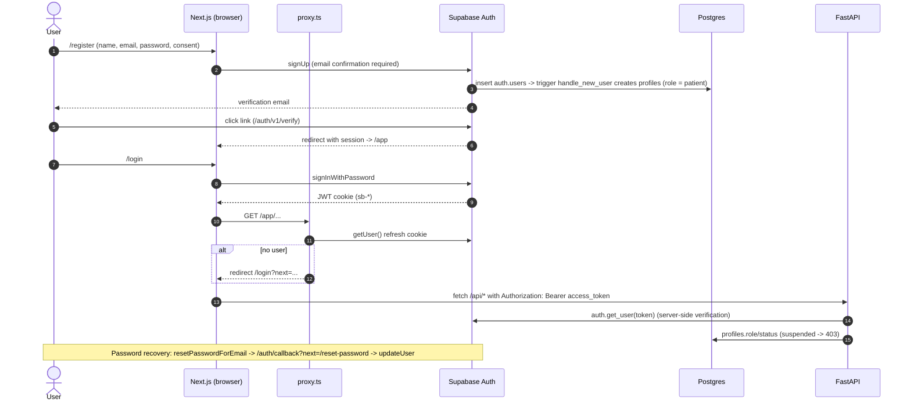

*(Source: `docs/diagrams/12_auth_workflow.mmd`; rendered PNG: `docs/diagrams/png/12_auth_workflow.png`)*
### 15.2 AI chat
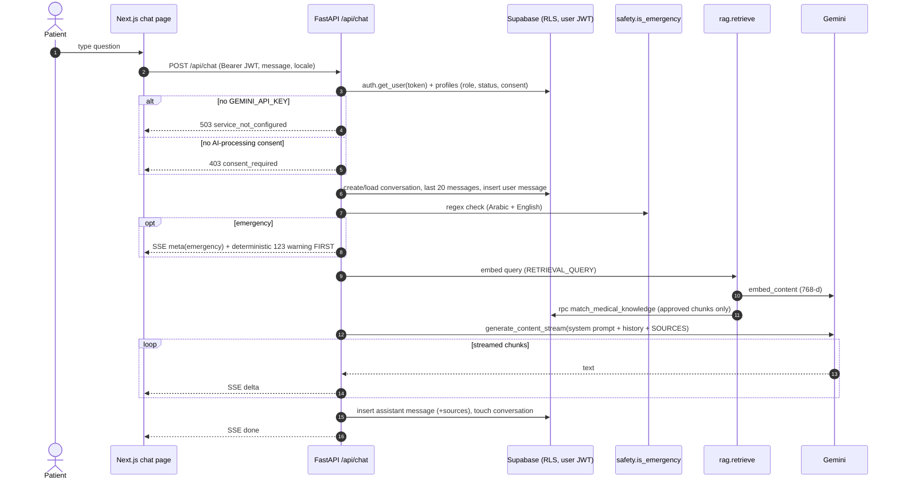

*(Source: `docs/diagrams/04_chat_workflow.mmd`; rendered PNG: `docs/diagrams/png/04_chat_workflow.png`)*
### 15.3 RAG
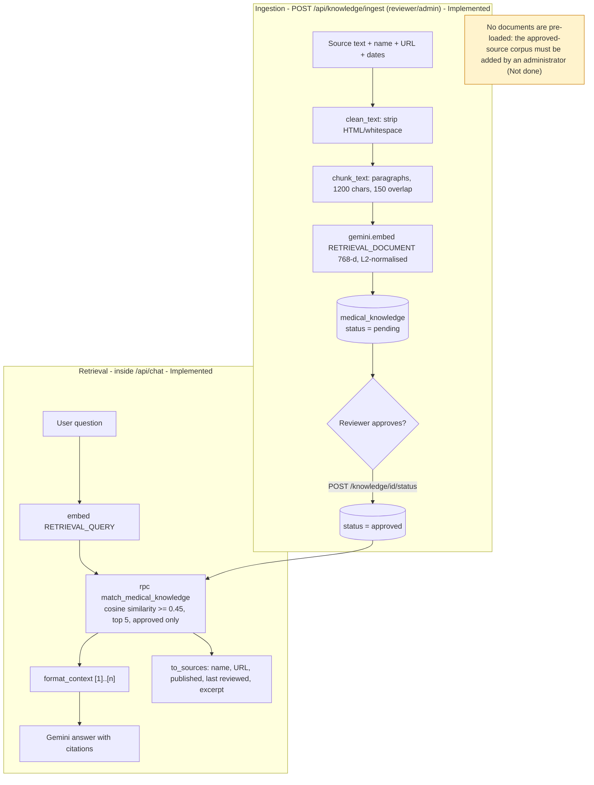

*(Source: `docs/diagrams/05_rag_workflow.mmd`; rendered PNG: `docs/diagrams/png/05_rag_workflow.png`)*
### 15.4 Machine learning
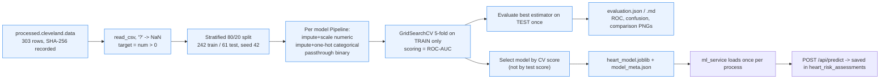

*(Source: `docs/diagrams/06_ml_workflow.mmd`; rendered PNG: `docs/diagrams/png/06_ml_workflow.png`)*
### 15.5 Medical upload
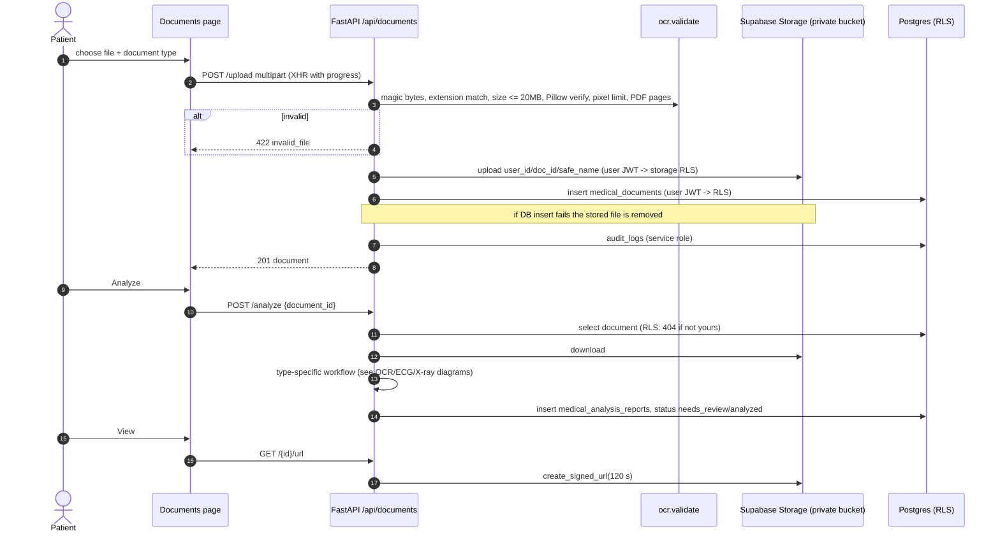

*(Source: `docs/diagrams/07_upload_workflow.mmd`; rendered PNG: `docs/diagrams/png/07_upload_workflow.png`)*
### 15.6 OCR
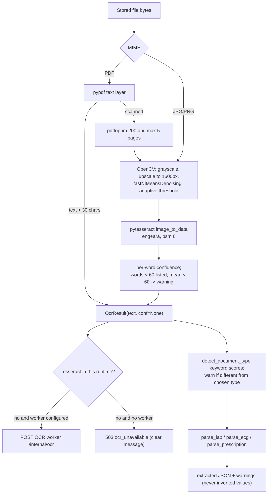

*(Source: `docs/diagrams/08_ocr_workflow.mmd`; rendered PNG: `docs/diagrams/png/08_ocr_workflow.png`)*
### 15.7 ECG (Implemented: printed numbers; Planned: waveform)
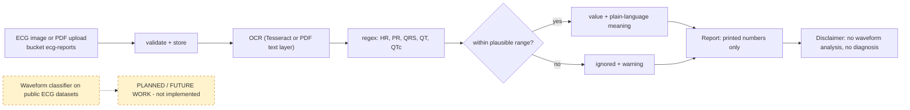

*(Source: `docs/diagrams/09_ecg_workflow.mmd`; rendered PNG: `docs/diagrams/png/09_ecg_workflow.png`)*
### 15.8 X-ray (Implemented: validation + metadata; Planned: classifier)
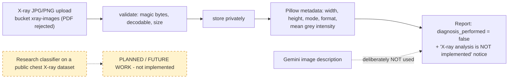

*(Source: `docs/diagrams/10_xray_workflow.mmd`; rendered PNG: `docs/diagrams/png/10_xray_workflow.png`)*
### 15.9 Prescription
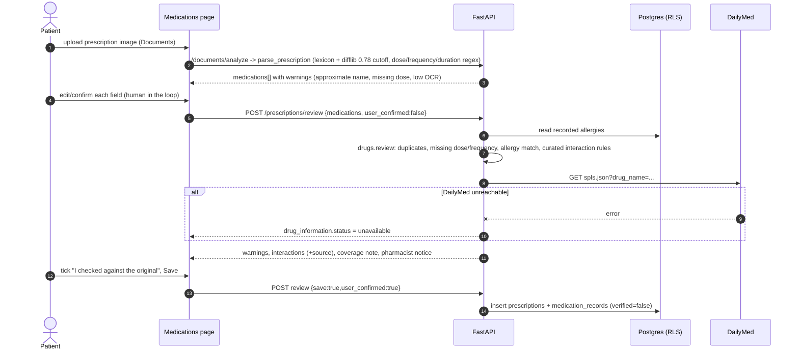

*(Source: `docs/diagrams/11_prescription_workflow.mmd`; rendered PNG: `docs/diagrams/png/11_prescription_workflow.png`)*
### 15.10 Deployment (target architecture; not yet deployed)
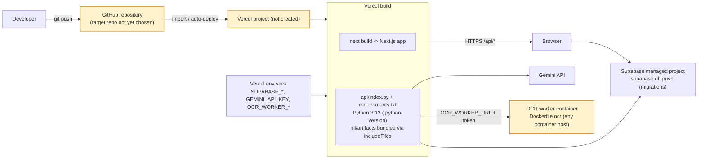

*(Source: `docs/diagrams/13_deployment.mmd`; rendered PNG: `docs/diagrams/png/13_deployment.png`)*

## 16. UML Diagrams
- **Use case diagram:** §12.
- **Class/module diagram** (Python backend; the code is functional/modular, so "classes" are Pydantic models and service modules):
```mermaid
classDiagram
  class CurrentUser { +str id +str email +str token +str role +str locale +bool consent_ai }
  class Settings { +supabase_url +gemini_api_key +gemini_model +ocr_worker_url +max_upload_bytes }
  class OcrResult { +str text +float mean_confidence +str engine +list warnings +list low_conf_words }
  class HeartInput { +int age +int sex +int cp +int trestbps +int chol +int fbs +int restecg +int thalach +int exang +float oldpeak +int slope +int ca +int thal }
  class ChatRequest { +str message +UUID conversation_id +str locale }
  class PrescriptionReviewRequest { +list medications +bool user_confirmed +bool save }
  class safety { +is_emergency(text) +EMERGENCY_NOTICE +SYSTEM_PROMPT }
  class gemini { +embed(texts, task) +stream_chat(...) }
  class rag { +clean_text() +chunk_text() +ingest() +retrieve() +to_sources() }
  class ml_service { +load_model() +model_meta() +predict(features) }
  class drugs { +review(meds, allergies) +dailymed_lookup(name) }
  class engine { +ocr_available() +preprocess() +ocr_image() +ocr_pdf() +extract_text() }
  class parsers { +detect_document_type() +parse_lab() +parse_ecg() +parse_prescription() }
  class validate { +sniff_mime() +validate_upload() +safe_filename() }
  CurrentUser <.. chat_router : Depends(get_current_user)
  Settings <.. gemini
  chat_router ..> safety
  chat_router ..> rag
  chat_router ..> gemini
  rag ..> gemini
  predict_router ..> ml_service
  predict_router ..> HeartInput
  documents_router ..> validate
  documents_router ..> engine
  documents_router ..> parsers
  engine --> OcrResult
  prescriptions_router ..> drugs
  prescriptions_router ..> PrescriptionReviewRequest
  chat_router ..> ChatRequest
```

*(Source: `docs/diagrams/14_class_diagram.mmd`; rendered PNG: `docs/diagrams/png/14_class_diagram.png`)*
- **Sequence diagrams:** §15.1, 15.2, 15.5, 15.9 (each step corresponds to a real function call).
- **ER diagram:** §18.

## 17. Data Flow Diagrams
**Level 0 (context)**
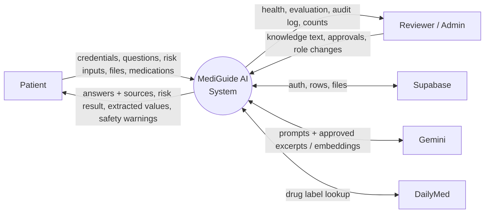

*(Source: `docs/diagrams/15_dfd_level0.mmd`; rendered PNG: `docs/diagrams/png/15_dfd_level0.png`)*
**Level 1**
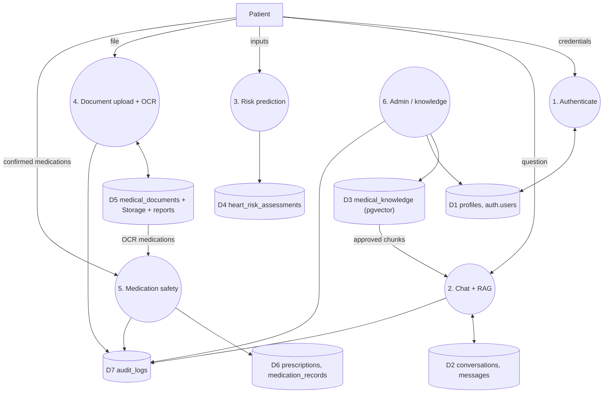

*(Source: `docs/diagrams/16_dfd_level1.mmd`; rendered PNG: `docs/diagrams/png/16_dfd_level1.png`)*

## 18. Entity Relationship Diagram
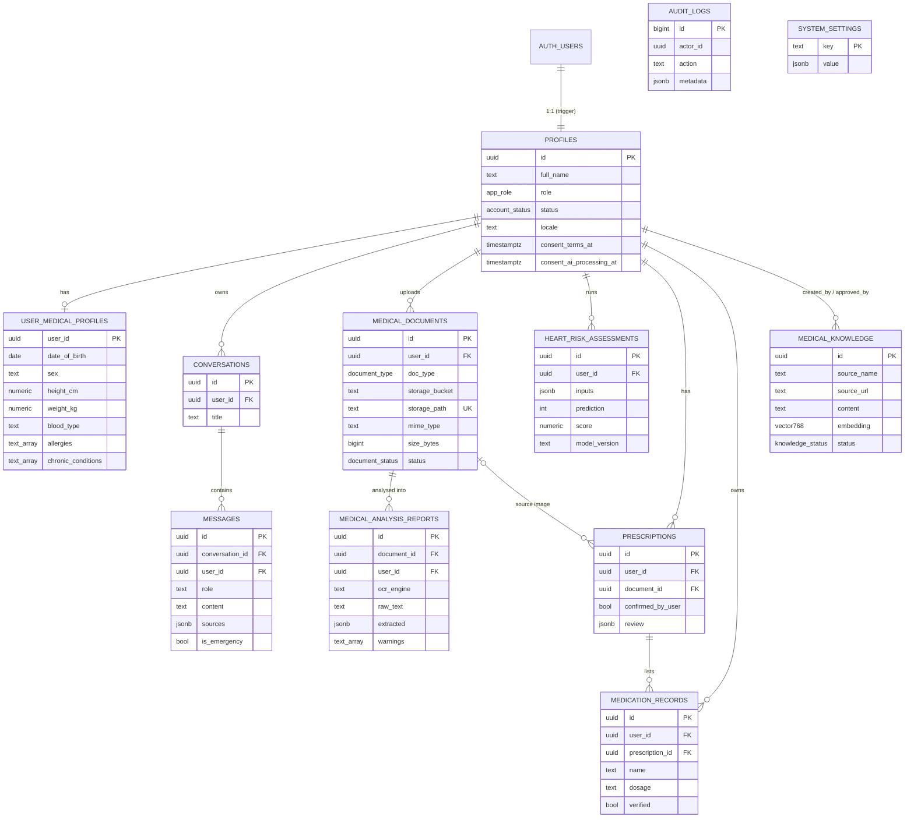

*(Source: `docs/diagrams/03_erd.mmd`; rendered PNG: `docs/diagrams/png/03_erd.png`)*

## 19. Database Design
Source of truth: `supabase/migrations/20260101000000_core_schema.sql` and `…000100_storage.sql`. Everything below is **extracted from the live local database** by `docs/build_docs.py`.

**Design principles.** UUID primary keys; every private row carries `user_id` referencing `profiles(id)` with `ON DELETE CASCADE` (deleting a user erases their data); enum types for roles/status/document type; CHECK constraints bound all free values (e.g. `size_bytes ≤ 20 MiB`, `score between 0 and 1`); `updated_at` triggers; `jsonb` only for variable OCR/review payloads; binary files **never** stored in PostgreSQL (only `storage_path`).

**Security triggers.** `protect_profile_fields` blocks non-admins from changing `role`/`status`; `assert_same_owner` forbids attaching a message/report/medication to another user's parent row; `handle_new_user` always creates role `patient`.

### Tables, columns, constraints, indexes


#### `audit_logs`

| Column | Type | Null | Default |
|---|---|---|---|
| id | bigint | NO | `` |
| actor_id | uuid | YES | `` |
| action | text | NO | `` |
| entity | text | YES | `` |
| entity_id | text | YES | `` |
| metadata | jsonb | NO | `'{}'::jsonb` |
| created_at | timestamp with time zone | NO | `now()` |

Constraints: `audit_logs_pkey`: PRIMARY KEY (id)

Indexes: `audit_actor_idx`; `audit_logs_pkey`

#### `conversations`

| Column | Type | Null | Default |
|---|---|---|---|
| id | uuid | NO | `gen_random_uuid()` |
| user_id | uuid | NO | `` |
| title | text | NO | `'New conversation'::text` |
| created_at | timestamp with time zone | NO | `now()` |
| updated_at | timestamp with time zone | NO | `now()` |

Constraints: `conversations_pkey`: PRIMARY KEY (id); `conversations_title_check`: CHECK ((char_length(title) <= 200)); `conversations_user_id_fkey`: FOREIGN KEY (user_id) REFERENCES profiles(id) ON DELETE CASCADE

Indexes: `conversations_pkey`; `conversations_user_idx`

#### `heart_risk_assessments`

| Column | Type | Null | Default |
|---|---|---|---|
| id | uuid | NO | `gen_random_uuid()` |
| user_id | uuid | NO | `` |
| inputs | jsonb | NO | `` |
| prediction | integer | NO | `` |
| score | numeric | NO | `` |
| model_version | text | NO | `` |
| created_at | timestamp with time zone | NO | `now()` |

Constraints: `heart_risk_assessments_pkey`: PRIMARY KEY (id); `heart_risk_assessments_prediction_check`: CHECK ((prediction = ANY (ARRAY[0, 1]))); `heart_risk_assessments_score_check`: CHECK (((score >= (0)::numeric) AND (score <= (1)::numeric))); `heart_risk_assessments_user_id_fkey`: FOREIGN KEY (user_id) REFERENCES profiles(id) ON DELETE CASCADE

Indexes: `heart_risk_assessments_pkey`; `hra_user_idx`

#### `medical_analysis_reports`

| Column | Type | Null | Default |
|---|---|---|---|
| id | uuid | NO | `gen_random_uuid()` |
| document_id | uuid | NO | `` |
| user_id | uuid | NO | `` |
| report_type | USER-DEFINED | NO | `` |
| ocr_engine | text | YES | `` |
| raw_text | text | YES | `` |
| extracted | jsonb | NO | `'{}'::jsonb` |
| warnings | ARRAY | NO | `'{}'::text[]` |
| user_confirmed | boolean | NO | `false` |
| created_at | timestamp with time zone | NO | `now()` |

Constraints: `medical_analysis_reports_document_id_fkey`: FOREIGN KEY (document_id) REFERENCES medical_documents(id) ON DELETE CASCADE; `medical_analysis_reports_pkey`: PRIMARY KEY (id); `medical_analysis_reports_user_id_fkey`: FOREIGN KEY (user_id) REFERENCES profiles(id) ON DELETE CASCADE

Indexes: `medical_analysis_reports_pkey`; `reports_doc_idx`; `reports_user_idx`

#### `medical_documents`

| Column | Type | Null | Default |
|---|---|---|---|
| id | uuid | NO | `gen_random_uuid()` |
| user_id | uuid | NO | `` |
| doc_type | USER-DEFINED | NO | `` |
| detected_type | USER-DEFINED | YES | `` |
| original_name | text | NO | `` |
| storage_bucket | text | NO | `` |
| storage_path | text | NO | `` |
| mime_type | text | NO | `` |
| size_bytes | bigint | NO | `` |
| sha256 | text | YES | `` |
| status | USER-DEFINED | NO | `'uploaded'::document_status` |
| created_at | timestamp with time zone | NO | `now()` |
| updated_at | timestamp with time zone | NO | `now()` |

Constraints: `medical_documents_original_name_check`: CHECK ((char_length(original_name) <= 255)); `medical_documents_pkey`: PRIMARY KEY (id); `medical_documents_size_bytes_check`: CHECK (((size_bytes > 0) AND (size_bytes <= 20971520))); `medical_documents_storage_path_key`: UNIQUE (storage_path); `medical_documents_user_id_fkey`: FOREIGN KEY (user_id) REFERENCES profiles(id) ON DELETE CASCADE

Indexes: `medical_documents_pkey`; `medical_documents_storage_path_key`; `medical_documents_user_idx`

#### `medical_knowledge`

| Column | Type | Null | Default |
|---|---|---|---|
| id | uuid | NO | `gen_random_uuid()` |
| source_name | text | NO | `` |
| source_url | text | NO | `` |
| title | text | NO | `` |
| language | text | NO | `'en'::text` |
| published_on | date | YES | `` |
| last_reviewed_on | date | YES | `` |
| content | text | NO | `` |
| chunk_index | integer | NO | `0` |
| embedding | USER-DEFINED | YES | `` |
| status | USER-DEFINED | NO | `'pending'::knowledge_status` |
| approved_by | uuid | YES | `` |
| created_by | uuid | YES | `` |
| created_at | timestamp with time zone | NO | `now()` |

Constraints: `medical_knowledge_approved_by_fkey`: FOREIGN KEY (approved_by) REFERENCES profiles(id); `medical_knowledge_content_check`: CHECK (((char_length(content) >= 20) AND (char_length(content) <= 8000))); `medical_knowledge_created_by_fkey`: FOREIGN KEY (created_by) REFERENCES profiles(id); `medical_knowledge_language_check`: CHECK ((language = ANY (ARRAY['ar'::text, 'en'::text]))); `medical_knowledge_pkey`: PRIMARY KEY (id); `medical_knowledge_source_url_check`: CHECK ((source_url ~ '^https?://'::text))

Indexes: `knowledge_embedding_idx`; `knowledge_status_idx`; `medical_knowledge_pkey`

#### `medication_records`

| Column | Type | Null | Default |
|---|---|---|---|
| id | uuid | NO | `gen_random_uuid()` |
| user_id | uuid | NO | `` |
| prescription_id | uuid | YES | `` |
| name | text | NO | `` |
| dosage | text | YES | `` |
| frequency | text | YES | `` |
| duration | text | YES | `` |
| ocr_confidence | numeric | YES | `` |
| verified | boolean | NO | `false` |
| active | boolean | NO | `true` |
| created_at | timestamp with time zone | NO | `now()` |

Constraints: `medication_records_name_check`: CHECK (((char_length(name) >= 1) AND (char_length(name) <= 200))); `medication_records_ocr_confidence_check`: CHECK (((ocr_confidence >= (0)::numeric) AND (ocr_confidence <= (1)::numeric))); `medication_records_pkey`: PRIMARY KEY (id); `medication_records_prescription_id_fkey`: FOREIGN KEY (prescription_id) REFERENCES prescriptions(id) ON DELETE CASCADE; `medication_records_user_id_fkey`: FOREIGN KEY (user_id) REFERENCES profiles(id) ON DELETE CASCADE

Indexes: `medication_records_pkey`; `medrec_user_idx`

#### `messages`

| Column | Type | Null | Default |
|---|---|---|---|
| id | uuid | NO | `gen_random_uuid()` |
| conversation_id | uuid | NO | `` |
| user_id | uuid | NO | `` |
| role | text | NO | `` |
| content | text | NO | `` |
| sources | jsonb | NO | `'[]'::jsonb` |
| is_emergency | boolean | NO | `false` |
| created_at | timestamp with time zone | NO | `now()` |

Constraints: `messages_content_check`: CHECK ((char_length(content) <= 20000)); `messages_conversation_id_fkey`: FOREIGN KEY (conversation_id) REFERENCES conversations(id) ON DELETE CASCADE; `messages_pkey`: PRIMARY KEY (id); `messages_role_check`: CHECK ((role = ANY (ARRAY['user'::text, 'assistant'::text]))); `messages_user_id_fkey`: FOREIGN KEY (user_id) REFERENCES profiles(id) ON DELETE CASCADE

Indexes: `messages_conv_idx`; `messages_pkey`

#### `prescriptions`

| Column | Type | Null | Default |
|---|---|---|---|
| id | uuid | NO | `gen_random_uuid()` |
| user_id | uuid | NO | `` |
| document_id | uuid | YES | `` |
| prescribed_on | date | YES | `` |
| prescriber | text | YES | `` |
| confirmed_by_user | boolean | NO | `false` |
| review | jsonb | NO | `'{}'::jsonb` |
| created_at | timestamp with time zone | NO | `now()` |

Constraints: `prescriptions_document_id_fkey`: FOREIGN KEY (document_id) REFERENCES medical_documents(id) ON DELETE SET NULL; `prescriptions_pkey`: PRIMARY KEY (id); `prescriptions_user_id_fkey`: FOREIGN KEY (user_id) REFERENCES profiles(id) ON DELETE CASCADE

Indexes: `prescriptions_pkey`; `prescriptions_user_idx`

#### `profiles`

| Column | Type | Null | Default |
|---|---|---|---|
| id | uuid | NO | `` |
| full_name | text | NO | `''::text` |
| role | USER-DEFINED | NO | `'patient'::app_role` |
| status | USER-DEFINED | NO | `'active'::account_status` |
| locale | text | NO | `'ar'::text` |
| consent_terms_at | timestamp with time zone | YES | `` |
| consent_ai_processing_at | timestamp with time zone | YES | `` |
| created_at | timestamp with time zone | NO | `now()` |
| updated_at | timestamp with time zone | NO | `now()` |

Constraints: `profiles_full_name_check`: CHECK ((char_length(full_name) <= 200)); `profiles_id_fkey`: FOREIGN KEY (id) REFERENCES auth.users(id) ON DELETE CASCADE; `profiles_locale_check`: CHECK ((locale = ANY (ARRAY['ar'::text, 'en'::text]))); `profiles_pkey`: PRIMARY KEY (id)

Indexes: `profiles_pkey`

#### `system_settings`

| Column | Type | Null | Default |
|---|---|---|---|
| key | text | NO | `` |
| value | jsonb | NO | `` |
| updated_at | timestamp with time zone | NO | `now()` |

Constraints: `system_settings_pkey`: PRIMARY KEY (key)

Indexes: `system_settings_pkey`

#### `user_medical_profiles`

| Column | Type | Null | Default |
|---|---|---|---|
| user_id | uuid | NO | `` |
| date_of_birth | date | YES | `` |
| sex | text | YES | `` |
| height_cm | numeric | YES | `` |
| weight_kg | numeric | YES | `` |
| blood_type | text | YES | `` |
| allergies | ARRAY | NO | `'{}'::text[]` |
| chronic_conditions | ARRAY | NO | `'{}'::text[]` |
| family_history | text | NO | `''::text` |
| smoker | boolean | YES | `` |
| created_at | timestamp with time zone | NO | `now()` |
| updated_at | timestamp with time zone | NO | `now()` |

Constraints: `user_medical_profiles_blood_type_check`: CHECK ((blood_type = ANY (ARRAY['A+'::text, 'A-'::text, 'B+'::text, 'B-'::text, 'AB+'::text, 'AB-'::text, 'O+'::text, 'O-'::text]))); `user_medical_profiles_date_of_birth_check`: CHECK ((date_of_birth <= CURRENT_DATE)); `user_medical_profiles_family_history_check`: CHECK ((char_length(family_history) <= 2000)); `user_medical_profiles_height_cm_check`: CHECK (((height_cm >= (30)::numeric) AND (height_cm <= (260)::numeric))); `user_medical_profiles_pkey`: PRIMARY KEY (user_id); `user_medical_profiles_sex_check`: CHECK ((sex = ANY (ARRAY['male'::text, 'female'::text]))); `user_medical_profiles_user_id_fkey`: FOREIGN KEY (user_id) REFERENCES profiles(id) ON DELETE CASCADE; `user_medical_profiles_weight_kg_check`: CHECK (((weight_kg >= (2)::numeric) AND (weight_kg <= (500)::numeric)))

Indexes: `user_medical_profiles_pkey`


### Row Level Security policies (live from `pg_policies`)
Owner-only tables give administrators **no** policy: an admin cannot read a patient's conversations, documents or assessments (tested).


| Table | Policy | Command | USING | WITH CHECK |
|---|---|---|---|---|
| audit_logs | audit_admin_read | SELECT | `is_admin()` | `` |
| audit_logs | audit_self_insert | INSERT | `` | `(actor_id = auth.uid())` |
| conversations | conversations_owner_delete | DELETE | `(user_id = auth.uid())` | `` |
| conversations | conversations_owner_insert | INSERT | `` | `(user_id = auth.uid())` |
| conversations | conversations_owner_select | SELECT | `(user_id = auth.uid())` | `` |
| conversations | conversations_owner_update | UPDATE | `(user_id = auth.uid())` | `(user_id = auth.uid())` |
| heart_risk_assessments | heart_risk_assessments_owner_delete | DELETE | `(user_id = auth.uid())` | `` |
| heart_risk_assessments | heart_risk_assessments_owner_insert | INSERT | `` | `(user_id = auth.uid())` |
| heart_risk_assessments | heart_risk_assessments_owner_select | SELECT | `(user_id = auth.uid())` | `` |
| heart_risk_assessments | heart_risk_assessments_owner_update | UPDATE | `(user_id = auth.uid())` | `(user_id = auth.uid())` |
| medical_analysis_reports | medical_analysis_reports_owner_delete | DELETE | `(user_id = auth.uid())` | `` |
| medical_analysis_reports | medical_analysis_reports_owner_insert | INSERT | `` | `(user_id = auth.uid())` |
| medical_analysis_reports | medical_analysis_reports_owner_select | SELECT | `(user_id = auth.uid())` | `` |
| medical_analysis_reports | medical_analysis_reports_owner_update | UPDATE | `(user_id = auth.uid())` | `(user_id = auth.uid())` |
| medical_documents | medical_documents_owner_delete | DELETE | `(user_id = auth.uid())` | `` |
| medical_documents | medical_documents_owner_insert | INSERT | `` | `(user_id = auth.uid())` |
| medical_documents | medical_documents_owner_select | SELECT | `(user_id = auth.uid())` | `` |
| medical_documents | medical_documents_owner_update | UPDATE | `(user_id = auth.uid())` | `(user_id = auth.uid())` |
| medical_knowledge | knowledge_admin_delete | DELETE | `is_admin()` | `` |
| medical_knowledge | knowledge_read_approved | SELECT | `((status = 'approved'::knowledge_status) OR is_reviewer())` | `` |
| medical_knowledge | knowledge_reviewer_insert | INSERT | `` | `is_reviewer()` |
| medical_knowledge | knowledge_reviewer_update | UPDATE | `is_reviewer()` | `is_reviewer()` |
| medication_records | medication_records_owner_delete | DELETE | `(user_id = auth.uid())` | `` |
| medication_records | medication_records_owner_insert | INSERT | `` | `(user_id = auth.uid())` |
| medication_records | medication_records_owner_select | SELECT | `(user_id = auth.uid())` | `` |
| medication_records | medication_records_owner_update | UPDATE | `(user_id = auth.uid())` | `(user_id = auth.uid())` |
| messages | messages_owner_delete | DELETE | `(user_id = auth.uid())` | `` |
| messages | messages_owner_insert | INSERT | `` | `(user_id = auth.uid())` |
| messages | messages_owner_select | SELECT | `(user_id = auth.uid())` | `` |
| messages | messages_owner_update | UPDATE | `(user_id = auth.uid())` | `(user_id = auth.uid())` |
| prescriptions | prescriptions_owner_delete | DELETE | `(user_id = auth.uid())` | `` |
| prescriptions | prescriptions_owner_insert | INSERT | `` | `(user_id = auth.uid())` |
| prescriptions | prescriptions_owner_select | SELECT | `(user_id = auth.uid())` | `` |
| prescriptions | prescriptions_owner_update | UPDATE | `(user_id = auth.uid())` | `(user_id = auth.uid())` |
| profiles | profiles_select | SELECT | `((id = auth.uid()) OR is_admin())` | `` |
| profiles | profiles_update_admin | UPDATE | `is_admin()` | `is_admin()` |
| profiles | profiles_update_own | UPDATE | `(id = auth.uid())` | `(id = auth.uid())` |
| system_settings | settings_admin_write | ALL | `is_admin()` | `is_admin()` |
| system_settings | settings_read | SELECT | `true` | `` |
| user_medical_profiles | user_medical_profiles_owner_delete | DELETE | `(user_id = auth.uid())` | `` |
| user_medical_profiles | user_medical_profiles_owner_insert | INSERT | `` | `(user_id = auth.uid())` |
| user_medical_profiles | user_medical_profiles_owner_select | SELECT | `(user_id = auth.uid())` | `` |
| user_medical_profiles | user_medical_profiles_owner_update | UPDATE | `(user_id = auth.uid())` | `(user_id = auth.uid())` |

Storage (`storage.objects`) policies:

| Policy | Command | USING | WITH CHECK |
|---|---|---|---|
| medical_files_owner_delete | DELETE | `((bucket_id = ANY (ARRAY['xray-images'::text, 'ecg-reports'::text, 'lab-reports'::text, 'prescriptions'::text, 'general-documents'::text])) AND ((stor` | `` |
| medical_files_owner_insert | INSERT | `` | `((bucket_id = ANY (ARRAY['xray-images'::text, 'ecg-reports'::text, 'lab-reports'::text, 'prescriptions'::text, 'general-documents'::text])) AND ((stor` |
| medical_files_owner_select | SELECT | `((bucket_id = ANY (ARRAY['xray-images'::text, 'ecg-reports'::text, 'lab-reports'::text, 'prescriptions'::text, 'general-documents'::text])) AND ((stor` | `` |


### Vector search function
```sql
select * from match_medical_knowledge(query_embedding := '[...768 floats...]', match_count := 5, min_similarity := 0.45);
-- cosine similarity = 1 - (embedding <=> query); only status = 'approved'; HNSW index on embedding vector_cosine_ops
```

### Representative SQL
```sql
-- A patient's latest assessments (RLS adds "user_id = auth.uid()" automatically)
select score, model_version, created_at from heart_risk_assessments order by created_at desc limit 5;
-- Admin: how many chunks await review
select count(*) from medical_knowledge where status = 'pending';
```

### The full migration source
```sql
-- MediGuide AI core schema. Every patient-owned table has RLS keyed on auth.uid().
create extension if not exists vector with schema extensions;
create extension if not exists pgcrypto with schema extensions;

create type public.app_role as enum ('patient', 'admin', 'medical_reviewer');
create type public.account_status as enum ('active', 'suspended');
create type public.document_type as enum ('xray', 'ecg', 'lab', 'prescription', 'general');
create type public.document_status as enum ('uploaded', 'processing', 'analyzed', 'needs_review', 'failed');
create type public.knowledge_status as enum ('pending', 'approved', 'rejected', 'archived');

create or replace function public.set_updated_at() returns trigger language plpgsql as $$
begin new.updated_at = now(); return new; end $$;

-- ---------- profiles ----------
create table public.profiles (
  id uuid primary key references auth.users(id) on delete cascade,
  full_name text not null default '' check (char_length(full_name) <= 200),
  role public.app_role not null default 'patient',
  status public.account_status not null default 'active',
  locale text not null default 'ar' check (locale in ('ar','en')),
  consent_terms_at timestamptz,
  consent_ai_processing_at timestamptz,   -- informed consent before sending data to Gemini
  created_at timestamptz not null default now(),
  updated_at timestamptz not null default now()
);
create trigger trg_profiles_updated before update on public.profiles for each row execute function public.set_updated_at();

create or replace function public.is_admin() returns boolean language sql stable security definer set search_path = public as $$
  select exists (select 1 from public.profiles where id = auth.uid() and role = 'admin' and status = 'active')
$$;
create or replace function public.is_reviewer() returns boolean language sql stable security definer set search_path = public as $$
  select exists (select 1 from public.profiles where id = auth.uid() and role in ('admin','medical_reviewer') and status = 'active')
$$;

-- new auth user -> profile (role is ALWAYS patient here; promotion is admin/service-role only)
create or replace function public.handle_new_user() returns trigger language plpgsql security definer set search_path = public as $$
begin
  insert into public.profiles (id, full_name, locale, consent_terms_at)
  values (new.id, coalesce(new.raw_user_meta_data->>'full_name',''),
          case when new.raw_user_meta_data->>'locale' = 'en' then 'en' else 'ar' end,
          case when (new.raw_user_meta_data->>'consent_terms') = 'true' then now() end);
  return new;
end $$;
create trigger on_auth_user_created after insert on auth.users for each row execute function public.handle_new_user();

-- block privilege escalation: users may not change role/status/their own consent-less fields via the API
create or replace function public.protect_profile_fields() returns trigger language plpgsql security definer set search_path = public as $$
begin
  if auth.uid() is not null and not public.is_admin() then
    if new.role is distinct from old.role or new.status is distinct from old.status then
      raise exception 'role/status can only be changed by an administrator' using errcode = '42501';
    end if;
  end if;
  return new;
end $$;
create trigger trg_protect_profile before update on public.profiles for each row execute function public.protect_profile_fields();

-- ---------- medical profile ----------
create table public.user_medical_profiles (
  user_id uuid primary key references public.profiles(id) on delete cascade,
  date_of_birth date check (date_of_birth <= current_date),
  sex text check (sex in ('male','female')),
  height_cm numeric(5,1) check (height_cm between 30 and 260),
  weight_kg numeric(5,1) check (weight_kg between 2 and 500),
  blood_type text check (blood_type in ('A+','A-','B+','B-','AB+','AB-','O+','O-')),
  allergies text[] not null default '{}',
  chronic_conditions text[] not null default '{}',
  family_history text not null default '' check (char_length(family_history) <= 2000),
  smoker boolean,
  created_at timestamptz not null default now(),
  updated_at timestamptz not null default now()
);
create trigger trg_ump_updated before update on public.user_medical_profiles for each row execute function public.set_updated_at();

-- ---------- chat ----------
create table public.conversations (
  id uuid primary key default gen_random_uuid(),
  user_id uuid not null references public.profiles(id) on delete cascade,
  title text not null default 'New conversation' check (char_length(title) <= 200),
  created_at timestamptz not null default now(),
  updated_at timestamptz not null default now()
);
create index conversations_user_idx on public.conversations (user_id, updated_at desc);
create table public.messages (
  id uuid primary key default gen_random_uuid(),
  conversation_id uuid not null references public.conversations(id) on delete cascade,
  user_id uuid not null references public.profiles(id) on delete cascade,
  role text not null check (role in ('user','assistant')),
  content text not null check (char_length(content) <= 20000),
  sources jsonb not null default '[]',
  is_emergency boolean not null default false,
  created_at timestamptz not null default now()
);
create index messages_conv_idx on public.messages (conversation_id, created_at);

-- ---------- documents ----------
create table public.medical_documents (
  id uuid primary key default gen_random_uuid(),
  user_id uuid not null references public.profiles(id) on delete cascade,
  doc_type public.document_type not null,
  detected_type public.document_type,
  original_name text not null check (char_length(original_name) <= 255),
  storage_bucket text not null,
  storage_path text not null unique,
  mime_type text not null,
  size_bytes bigint not null check (size_bytes > 0 and size_bytes <= 20971520),
  sha256 text,
  status public.document_status not null default 'uploaded',
  created_at timestamptz not null default now(),
  updated_at timestamptz not null default now()
);
create index medical_documents_user_idx on public.medical_documents (user_id, created_at desc);
create trigger trg_docs_updated before update on public.medical_documents for each row execute function public.set_updated_at();

create table public.medical_analysis_reports (
  id uuid primary key default gen_random_uuid(),
  document_id uuid not null references public.medical_documents(id) on delete cascade,
  user_id uuid not null references public.profiles(id) on delete cascade,
  report_type public.document_type not null,
  ocr_engine text,
  raw_text text,
  extracted jsonb not null default '{}',       -- structured values, each with confidence
  warnings text[] not null default '{}',
  user_confirmed boolean not null default false,
  created_at timestamptz not null default now()
);
create index reports_doc_idx on public.medical_analysis_reports (document_id);
create index reports_user_idx on public.medical_analysis_reports (user_id, created_at desc);

create table public.heart_risk_assessments (
  id uuid primary key default gen_random_uuid(),
  user_id uuid not null references public.profiles(id) on delete cascade,
  inputs jsonb not null,
  prediction int not null check (prediction in (0,1)),
  score numeric(5,4) not null check (score between 0 and 1),
  model_version text not null,
  created_at timestamptz not null default now()
);
create index hra_user_idx on public.heart_risk_assessments (user_id, created_at desc);

create table public.prescriptions (
  id uuid primary key default gen_random_uuid(),
  user_id uuid not null references public.profiles(id) on delete cascade,
  document_id uuid references public.medical_documents(id) on delete set null,
  prescribed_on date,
  prescriber text,
  confirmed_by_user boolean not null default false,
  review jsonb not null default '{}',          -- interaction/duplicate/allergy warnings + sources
  created_at timestamptz not null default now()
);
create index prescriptions_user_idx on public.prescriptions (user_id, created_at desc);

create table public.medication_records (
  id uuid primary key default gen_random_uuid(),
  user_id uuid not null references public.profiles(id) on delete cascade,
  prescription_id uuid references public.prescriptions(id) on delete cascade,
  name text not null check (char_length(name) between 1 and 200),
  dosage text,
  frequency text,
  duration text,
  ocr_confidence numeric(4,3) check (ocr_confidence between 0 and 1),
  verified boolean not null default false,
  active boolean not null default true,
  created_at timestamptz not null default now()
);
create index medrec_user_idx on public.medication_records (user_id, active);

-- ---------- knowledge base (RAG) ----------
create table public.medical_knowledge (
  id uuid primary key default gen_random_uuid(),
  source_name text not null,
  source_url text not null check (source_url ~ '^https?://'),
  title text not null,
  language text not null default 'en' check (language in ('ar','en')),
  published_on date,
  last_reviewed_on date,
  content text not null check (char_length(content) between 20 and 8000),
  chunk_index int not null default 0,
  embedding extensions.vector(768),
  status public.knowledge_status not null default 'pending',
  approved_by uuid references public.profiles(id),
  created_by uuid references public.profiles(id),
  created_at timestamptz not null default now()
);
create index knowledge_status_idx on public.medical_knowledge (status);
create index knowledge_embedding_idx on public.medical_knowledge using hnsw (embedding extensions.vector_cosine_ops);

create or replace function public.match_medical_knowledge(query_embedding extensions.vector(768), match_count int default 5, min_similarity float default 0.45)
returns table (id uuid, source_name text, source_url text, title text, published_on date, last_reviewed_on date, content text, similarity float)
language sql stable security invoker set search_path = public, extensions as $$
  select k.id, k.source_name, k.source_url, k.title, k.published_on, k.last_reviewed_on, k.content,
         1 - (k.embedding <=> query_embedding) as similarity
  from public.medical_knowledge k
  where k.status = 'approved' and k.embedding is not null
    and 1 - (k.embedding <=> query_embedding) >= min_similarity
  order by k.embedding <=> query_embedding
  limit least(match_count, 20)
$$;

-- ---------- audit + settings ----------
create table public.audit_logs (
  id bigint generated always as identity primary key,
  actor_id uuid,
  action text not null,
  entity text,
  entity_id text,
  metadata jsonb not null default '{}',   -- never contains medical content
  created_at timestamptz not null default now()
);
create index audit_actor_idx on public.audit_logs (actor_id, created_at desc);
create table public.system_settings (
  key text primary key,
  value jsonb not null,
  updated_at timestamptz not null default now()
);
insert into public.system_settings (key, value) values
  ('retention_days_documents', '365'), ('max_upload_mb', '20'), ('emergency_number_eg', '"123"');

-- ================= RLS =================
alter table public.profiles enable row level security;
alter table public.user_medical_profiles enable row level security;
alter table public.conversations enable row level security;
alter table public.messages enable row level security;
alter table public.medical_documents enable row level security;
alter table public.medical_analysis_reports enable row level security;
alter table public.heart_risk_assessments enable row level security;
alter table public.prescriptions enable row level security;
alter table public.medication_records enable row level security;
alter table public.medical_knowledge enable row level security;
alter table public.audit_logs enable row level security;
alter table public.system_settings enable row level security;

create policy profiles_select on public.profiles for select to authenticated using (id = auth.uid() or public.is_admin());
create policy profiles_update_own on public.profiles for update to authenticated using (id = auth.uid()) with check (id = auth.uid());
create policy profiles_update_admin on public.profiles for update to authenticated using (public.is_admin()) with check (public.is_admin());
-- no INSERT policy (trigger does it) and no DELETE policy (deletion goes through the backend / auth.users cascade)

-- Owner-only tables (admins deliberately get NO access to private medical rows)
do $$
declare t text;
begin
  foreach t in array array['user_medical_profiles','conversations','messages','medical_documents',
                           'medical_analysis_reports','heart_risk_assessments','prescriptions','medication_records']
  loop
    execute format('create policy %I_owner_select on public.%I for select to authenticated using (user_id = auth.uid())', t, t);
    execute format('create policy %I_owner_insert on public.%I for insert to authenticated with check (user_id = auth.uid())', t, t);
    execute format('create policy %I_owner_update on public.%I for update to authenticated using (user_id = auth.uid()) with check (user_id = auth.uid())', t, t);
    execute format('create policy %I_owner_delete on public.%I for delete to authenticated using (user_id = auth.uid())', t, t);
  end loop;
end $$;

-- child rows must reference a parent owned by the same user (prevents cross-tenant linking)
create or replace function public.assert_same_owner() returns trigger language plpgsql security definer set search_path = public as $$
declare parent_owner uuid; j jsonb := to_jsonb(new);
begin
  if tg_table_name = 'messages' then
    select user_id into parent_owner from public.conversations where id = (j->>'conversation_id')::uuid;
  elsif tg_table_name = 'medical_analysis_reports' then
    select user_id into parent_owner from public.medical_documents where id = (j->>'document_id')::uuid;
  elsif tg_table_name = 'medication_records' then
    if j->>'prescription_id' is null then return new; end if;
    select user_id into parent_owner from public.prescriptions where id = (j->>'prescription_id')::uuid;
  elsif tg_table_name = 'prescriptions' then
    if j->>'document_id' is null then return new; end if;
    select user_id into parent_owner from public.medical_documents where id = (j->>'document_id')::uuid;
  else
    return new;
  end if;
  if parent_owner is distinct from new.user_id then raise exception 'parent row belongs to another user' using errcode = '42501'; end if;
  return new;
end $$;
create trigger trg_owner_messages before insert or update on public.messages for each row execute function public.assert_same_owner();
create trigger trg_owner_reports before insert or update on public.medical_analysis_reports for each row execute function public.assert_same_owner();
create trigger trg_owner_medrec before insert or update on public.medication_records for each row execute function public.assert_same_owner();
create trigger trg_owner_rx before insert or update on public.prescriptions for each row execute function public.assert_same_owner();

-- knowledge: patients read approved only; reviewers/admins manage
create policy knowledge_read_approved on public.medical_knowledge for select to authenticated using (status = 'approved' or public.is_reviewer());
create policy knowledge_reviewer_insert on public.medical_knowledge for insert to authenticated with check (public.is_reviewer());
create policy knowledge_reviewer_update on public.medical_knowledge for update to authenticated using (public.is_reviewer()) with check (public.is_reviewer());
create policy knowledge_admin_delete on public.medical_knowledge for delete to authenticated using (public.is_admin());

create policy audit_admin_read on public.audit_logs for select to authenticated using (public.is_admin());
create policy audit_self_insert on public.audit_logs for insert to authenticated with check (actor_id = auth.uid());
create policy settings_read on public.system_settings for select to authenticated using (true);
create policy settings_admin_write on public.system_settings for all to authenticated using (public.is_admin()) with check (public.is_admin());

grant usage on schema public to authenticated, service_role;
grant select, insert, update, delete on all tables in schema public to authenticated;
revoke all on all tables in schema public from anon;
grant usage, select on all sequences in schema public to authenticated;
grant execute on function public.match_medical_knowledge to authenticated;

```
```sql
-- Private buckets. Object path convention: <user_id>/<document_id>/<filename>
insert into storage.buckets (id, name, public, file_size_limit, allowed_mime_types) values
  ('xray-images',       'xray-images',       false, 20971520, array['image/jpeg','image/png']),
  ('ecg-reports',       'ecg-reports',       false, 20971520, array['image/jpeg','image/png','application/pdf']),
  ('lab-reports',       'lab-reports',       false, 20971520, array['image/jpeg','image/png','application/pdf']),
  ('prescriptions',     'prescriptions',     false, 20971520, array['image/jpeg','image/png','application/pdf']),
  ('general-documents', 'general-documents', false, 20971520, array['image/jpeg','image/png','application/pdf'])
on conflict (id) do update set public = false, file_size_limit = excluded.file_size_limit, allowed_mime_types = excluded.allowed_mime_types;

create policy medical_files_owner_select on storage.objects for select to authenticated
  using (bucket_id in ('xray-images','ecg-reports','lab-reports','prescriptions','general-documents')
         and (storage.foldername(name))[1] = auth.uid()::text);
create policy medical_files_owner_insert on storage.objects for insert to authenticated
  with check (bucket_id in ('xray-images','ecg-reports','lab-reports','prescriptions','general-documents')
         and (storage.foldername(name))[1] = auth.uid()::text);
create policy medical_files_owner_delete on storage.objects for delete to authenticated
  using (bucket_id in ('xray-images','ecg-reports','lab-reports','prescriptions','general-documents')
         and (storage.foldername(name))[1] = auth.uid()::text);

```
