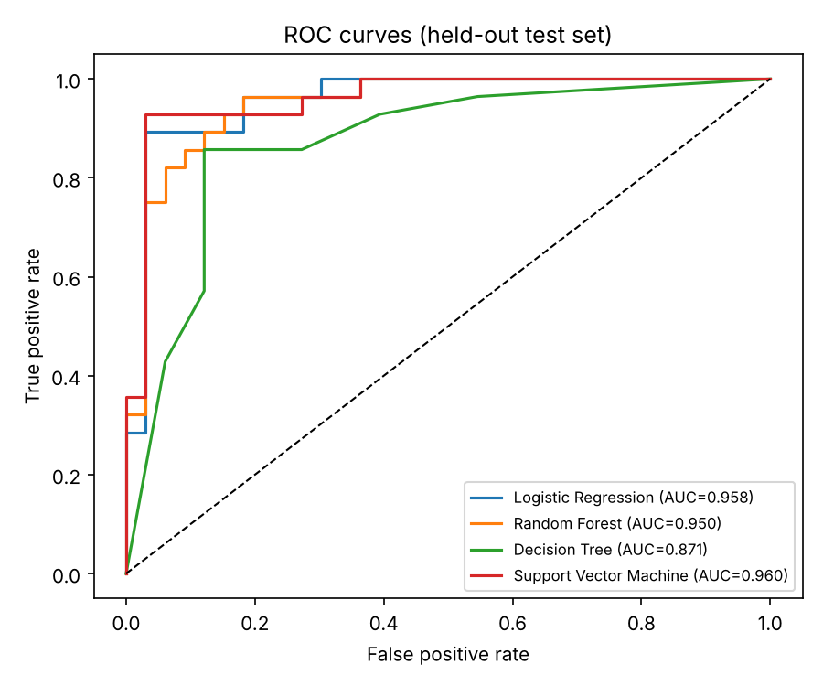
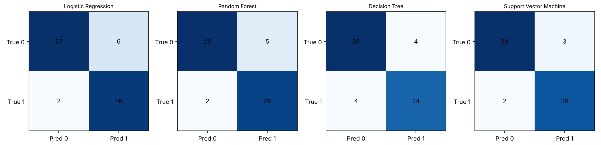
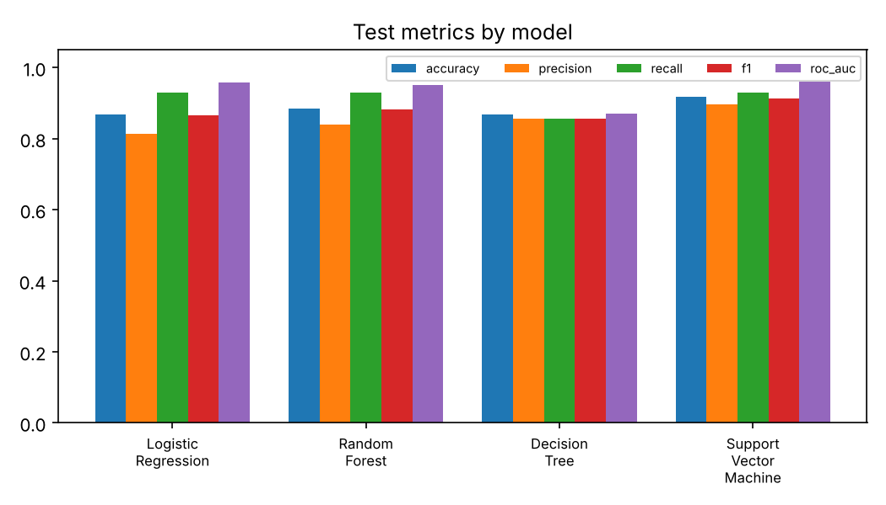

# Evaluation report (mediguide-heart-1.0.0)

Generated 2026-11-22T21:29:30+00:00 by `python -m ml.train`. Rows: 303 (train 242, test 61). Selected: **Logistic Regression** (highest 5-fold CV ROC-AUC on the training split).

| Model | Acc | Prec | Rec | F1 | ROC-AUC | CV AUC (train) | TN | FP | FN | TP |
|---|---|---|---|---|---|---|---|---|---|---|
| Logistic Regression | 0.8689 | 0.8125 | 0.9286 | 0.8667 | 0.9578 | 0.9069 | 27 | 6 | 2 | 26 |
| Random Forest | 0.8852 | 0.8387 | 0.9286 | 0.8814 | 0.9502 | 0.8985 | 28 | 5 | 2 | 26 |
| Decision Tree | 0.8689 | 0.8571 | 0.8571 | 0.8571 | 0.8712 | 0.8413 | 29 | 4 | 4 | 24 |
| Support Vector Machine | 0.918 | 0.8966 | 0.9286 | 0.9123 | 0.96 | 0.9044 | 30 | 3 | 2 | 26 |

Test set has only 61 patients: differences between models are within statistical noise.

